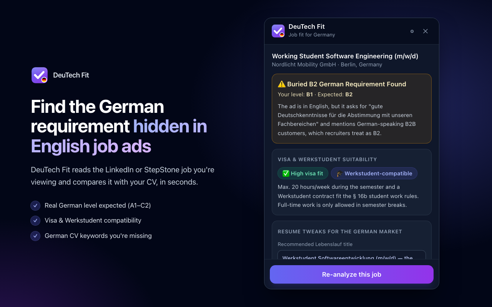
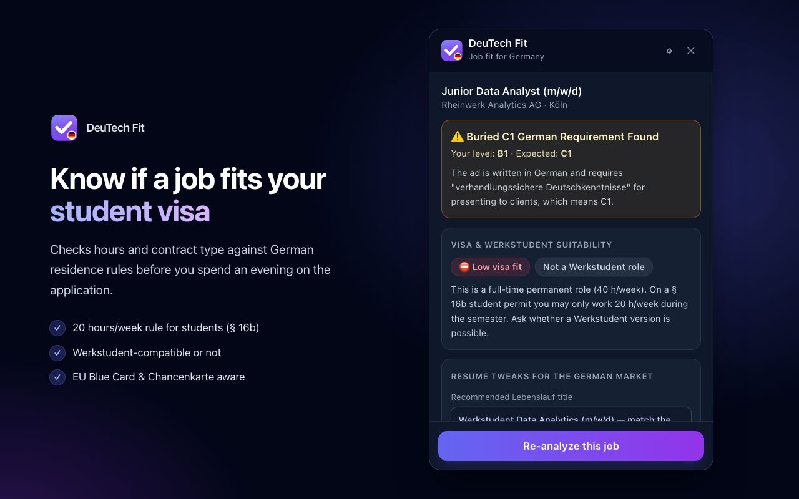
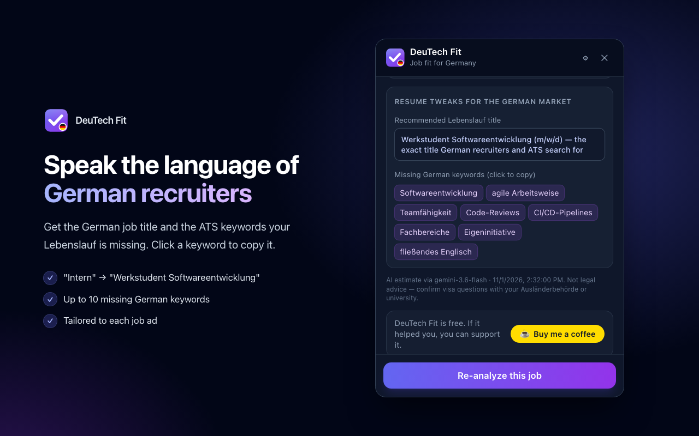
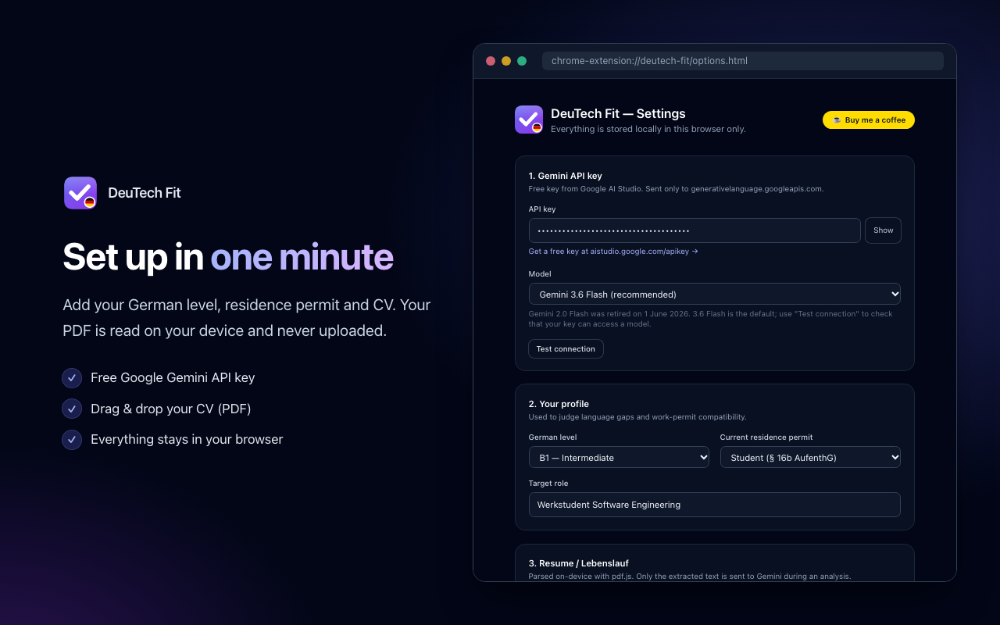
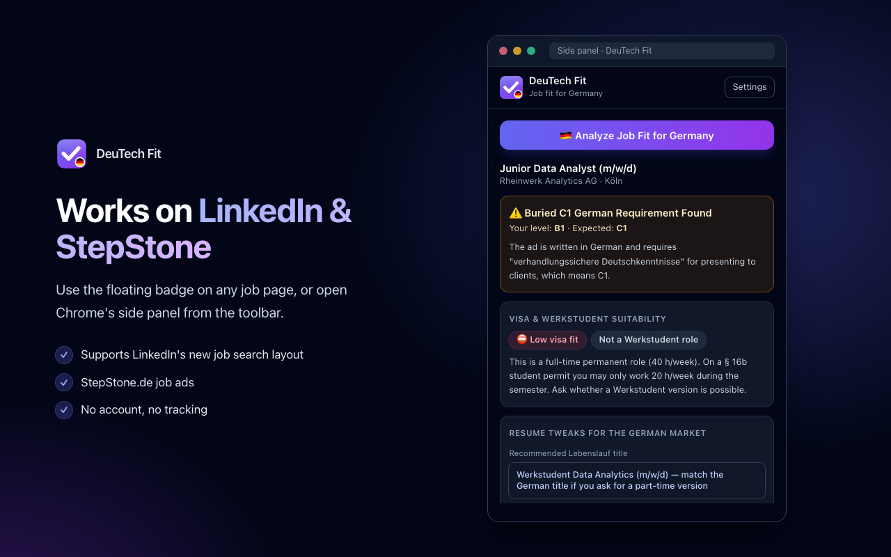

<p align="center">
  
</p>

<h1 align="center">DeuTech Fit</h1>

<p align="center">
  <b>Job fit for Germany: hidden German requirements, visa & Werkstudent compatibility, and German CV keywords, right on LinkedIn and StepStone.</b>
</p>

<p align="center">
  
  
  
  
  
  
</p>

<p align="center">
  
</p>

---

## Why

International students applying for jobs in Germany keep hitting the same three walls:

1. **The ad is in English, but they expect German.** Phrases like *"gute Deutschkenntnisse"* sit in paragraph six, or are only implied.
2. **The job doesn't fit the visa.** A student permit (§ 16b AufenthG) allows max. 20 h/week during the semester, so many full-time roles are off-limits.
3. **The CV speaks the wrong language.** German recruiters and ATS search for *"Werkstudent Softwareentwicklung"*, not *"Software Engineering Intern"*.

DeuTech Fit checks all three with one click on the job you're already looking at.

## Features

| | |
|---|---|
| 🇩🇪 **Hidden German level** | Detects the German level (A1–C2) the employer really expects, even in English ads, and warns you if it's above yours: *"⚠️ Buried B2 German Requirement Found"* |
| 🎓 **Visa & Werkstudent fit** | HIGH / MEDIUM / LOW rating against German residence rules: the 20 h/week student rule, Werkstudent contracts, EU Blue Card salary thresholds, Chancenkarte, post-study job search |
| 📄 **Lebenslauf localisation** | Recommends the German job title for your CV and lists up to 10 German ATS keywords missing from it. Click a keyword to copy it |
| 🧩 **Works where you search** | Floating panel on LinkedIn Jobs (including the new search layout) and StepStone.de, plus Chrome's side panel |
| 🔒 **Private by design** | CV parsed on-device with pdf.js, settings stored in `chrome.storage.local`, no account, no tracking, no backend |

<p align="center">
  
  
</p>
<p align="center">
  
  
</p>

## How it works

```
LinkedIn / StepStone page
        │  click "Analyze Job Fit for Germany"
        ▼
Content script ── extracts title, company, location, description
        │           1. LinkedIn: job ID → public job-posting endpoint (stable markup, full text)
        │           2. schema.org JobPosting JSON-LD (StepStone)
        │           3. site selectors → "About the job" text anchor → heuristic fallback
        ▼
Background service worker ── Gemini API (structured JSON output, your own key)
        │
        ▼
Results card (overlay + side panel)
```

Gemini is called with a strict `responseSchema`, so the result is always this shape:

```json
{
  "hidden_german_level": "NONE | A1 | A2 | B1 | B2 | C1 | C2",
  "hidden_german_explanation": "string",
  "visa_fit_status": "HIGH | MEDIUM | LOW",
  "visa_notes": "string",
  "werkstudent_equivalent": true,
  "title_recommendation": "string",
  "missing_german_keywords": ["string"]
}
```

## Getting started

### Install from source

Requires Node.js 18+ and Chrome 116+.

```bash
git clone https://github.com/owaistaha/deutech-fit.git
cd deutech-fit
npm install
npm run dev
```

1. Open `chrome://extensions` and turn on **Developer mode**.
2. Click **Load unpacked** and select `build/chrome-mv3-dev`.
3. The settings page opens automatically on install.

### Set up

1. Get a free Gemini API key at [aistudio.google.com/apikey](https://aistudio.google.com/apikey), paste it in Settings, and click **Test connection**.
2. Choose your German level, residence permit and target role.
3. Drop in your CV (PDF). The text is extracted locally, and you can edit it.
4. Open a job on LinkedIn or StepStone, click the **DeuTech Fit** badge (bottom-right), then **Analyze**.

### Scripts

| Command | What it does |
|---|---|
| `npm run dev` | Dev build with hot reload → `build/chrome-mv3-dev` |
| `npm run build` | Production build → `build/chrome-mv3-prod` |
| `npm run package` | Production build + zip for the Chrome Web Store |
| `npm run typecheck` | TypeScript check (strict mode) |

## Project structure

```
src/
├── background/index.ts        # Service worker: Gemini calls, LinkedIn fallback fetch, side panel setup
├── contents/
│   ├── analyzer-overlay.tsx   # On-page floating badge + results panel (shadow DOM UI)
│   └── job-scraper.ts         # Answers scrape requests from the side panel
├── components/
│   ├── ResultsCard.tsx        # Language warning, visa tags, CV tweaks
│   ├── ResumeDropzone.tsx     # Drag-and-drop PDF upload
│   ├── SupportButton.tsx      # Buy me a coffee
│   └── Logo.tsx
├── lib/
│   ├── scraper.ts             # Job extraction: guest endpoint, JSON-LD, selectors, heuristics
│   ├── gemini-analyzer.ts     # Prompt, response schema, validation, error handling
│   ├── germany-rules.ts       # Residence-permit facts used in the prompt (update yearly)
│   ├── pdf.ts                 # On-device PDF text extraction
│   ├── storage.ts             # chrome.storage.local keys and settings
│   ├── messages.ts            # Typed extension messaging
│   └── types.ts
├── options.tsx                # Settings page
└── sidepanel.tsx              # Chrome side panel
store/                         # Chrome Web Store listing, privacy policy, images
```

## Privacy

- Your CV PDF is parsed **in your browser** and never uploaded.
- Settings, CV text and your API key live only in `chrome.storage.local`.
- When you click **Analyze**, the job text and CV text are sent **only** to Google's Gemini API, using **your** key.
- There is no DeuTech Fit server, analytics or tracking.

Full policy: **[owaistaha.github.io/deutech-fit-privacy/privacy.html](https://owaistaha.github.io/deutech-fit-privacy/privacy.html)**

## Notes

- **Not legal advice.** Visa results are AI-generated guidance based on public German residence rules. Always confirm with your Ausländerbehörde or your university's international office.
- **Yearly update:** EU Blue Card salary thresholds change every January. Update them in `src/lib/germany-rules.ts`.
- **Model:** defaults to `gemini-3.6-flash`. You can change it in Settings.
- **LinkedIn markup changes often.** If extraction breaks, the error message shows which extraction step failed; add new selectors in `src/lib/scraper.ts`.

## Support

DeuTech Fit is free. If it helped your job search, you can support it:

<a href="https://buymeacoffee.com/owaistaha6h"></a>

## Author

**Owais Taha**: [GitHub](https://github.com/owaistaha)

DeuTech Fit is an independent project and is not affiliated with LinkedIn, StepStone or Google.

© 2026 Owais Taha. All rights reserved.
